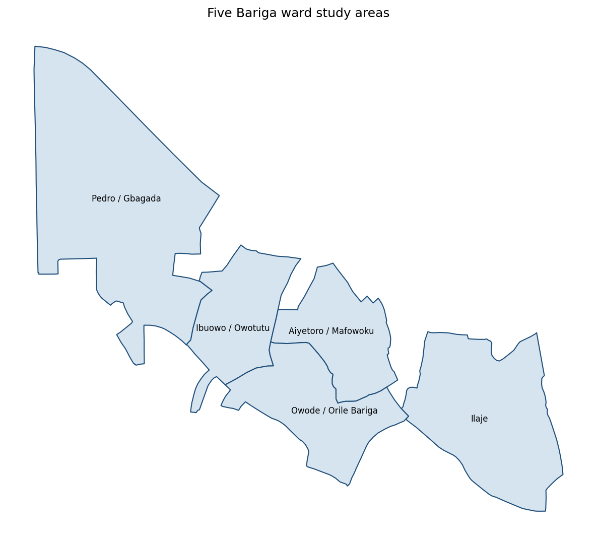
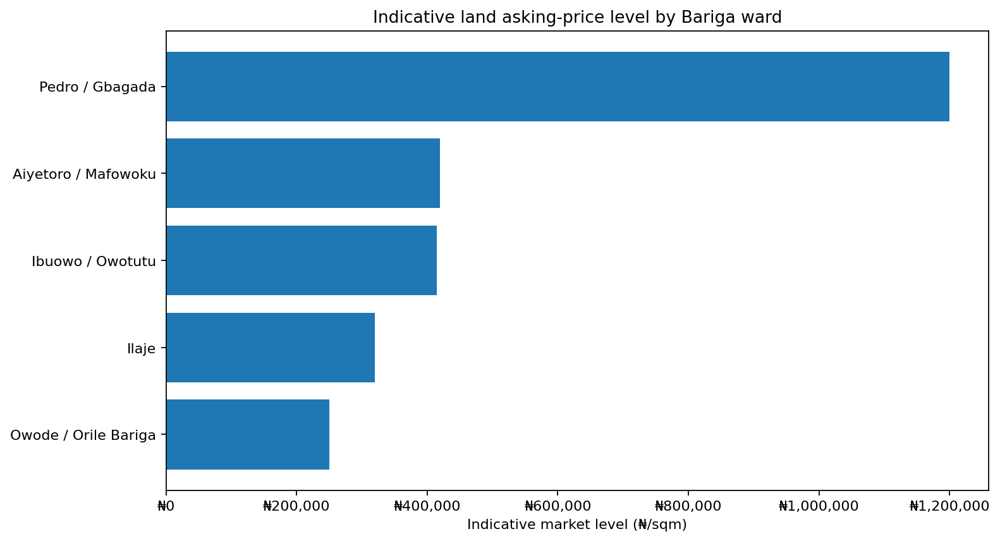
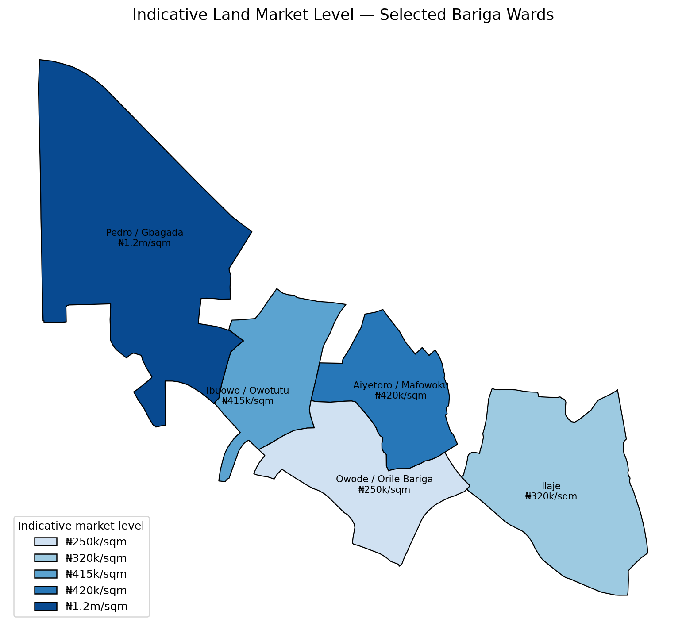
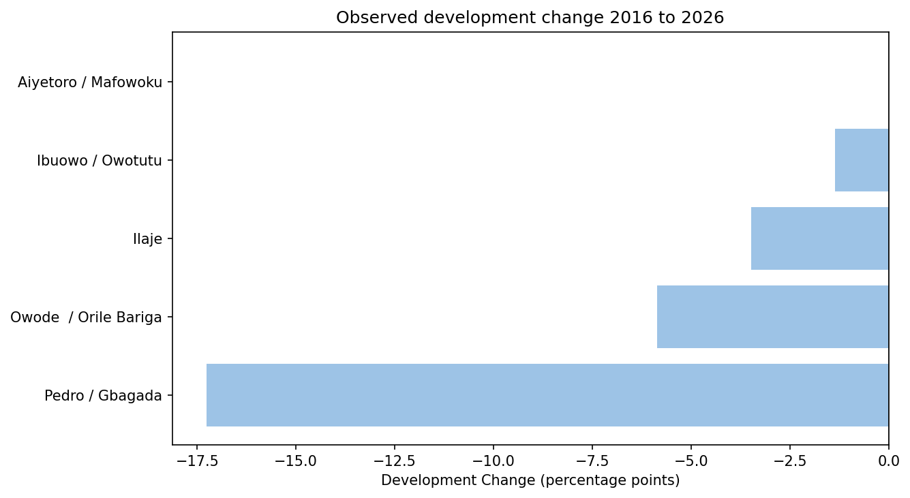

# Web-Based Land Value Intelligence Tool --- Bariga LCDA, Lagos

This project is a spatial analysis workflow for exploring **current land
market asking-price signals** and, in later stages, comparing them with
observed physical development change within selected areas of Bariga
LCDA, Lagos.

The work was completed progressively through the GeoRAD technical
sprints. Sprint 1 established the spatial study areas, Sprint 2
collected the market data, and Sprint 3 converted that market data into
a spatial market-intelligence layer.

> **Important:** The market figures in this project are indicative
> asking-price signals. They are not formal property valuations,
> confirmed transaction prices, or predictions of future land prices.

------------------------------------------------------------------------

# 1. Project Objective

The broader project is a **Web-based Land Value Intelligence Tool**
designed to help users explore:

1.  Current market range
2.  Five-year development change
3.  Development potential
4.  Spatial differences between selected locations

For the market-data component, the objective is to understand whether
current land asking-price signals differ across selected areas of Bariga
and to prepare the market layer for comparison with the
physical-development signal in a later stage.

The analysis does **not** attempt to determine which area is better or
to predict future land prices.

------------------------------------------------------------------------

# 2. Study Area and Spatial Preparation --- Sprint 1

The assigned LCDA was **Bariga**.

The initial spatial exploration used GRID3 administrative and ward data.
Because the available administrative structure represented the area
through LGA and ward boundaries, Bariga had to be carefully separated
from the wider Shomolu LGA.

I filtered the ward data specifically to:

-   `lganame = Shomolu`
-   `statename = Lagos`

I then identified the eight wards associated with Bariga and dissolved
them to create a working Bariga LCDA boundary.

For the technical sprint, the mentor later requested **polygon features
instead of point locations**. I therefore selected five actual ward
polygons:

1.  Ibuowo / Owotutu
2.  Ilaje
3.  Pedro / Gbagada
4.  Aiyetoro / Mafowoku
5.  Owode / Orile Bariga

The five wards were kept as **separate polygons** because each ward is
treated as an individual study area.

### Tools used

-   QGIS
-   GRID3 spatial data
-   Google Maps
-   GeoJSON
-   Python/Google Colab

One practical challenge was that OpenStreetMap tiles were not accessible
in my environment, so I used Google Maps as the QGIS basemap.

A major lesson from Sprint 1 was that **place names alone are not enough
when working with spatial data**. LGA, state and ward attributes had to
be checked carefully to avoid selecting similarly named locations
outside the study area.

*Figure 1. Five selected ward polygons used as the
technical-sprint study areas in Bariga LCDA.*

------------------------------------------------------------------------

# 3. Spatial Questions to Market Data --- Sprint 2

## 3.1 Purpose

Sprint 2 connected the selected spatial areas with current land-market
information.

For each selected ward, I collected:

-   Town/Ward
-   Current Land Price/sqm
-   Supporting Source
-   Date Searched

The search question was adapted as:

> **"Current asking price of residential land per sqm in \[Town\],
> Shomolu Lagos Nigeria"**

The workflow used the GeoRAD Google Colab notebook and AI-assisted
search results.

## 3.2 Sprint 2 Market Dataset

The resulting dataset contained one selected market-price signal for
each study area:

| Study area | Current asking-price signal |
| --- | ---: |
| Ibuowo / Owotutu | ₦415,000/sqm |
| Ilaje | ₦320,000/sqm |
| Pedro / Gbagada | ₦1,200,000/sqm |
| Aiyetoro / Mafowoku | ₦420,000/sqm |
| Owode / Orile Bariga | ₦250,000/sqm |

These are the values carried forward into Sprint 3.

The original AI-assisted search sometimes returned **ranges** rather
than one value. The structured Sprint 2 dataset contains one selected
value per study area, so these values should not be interpreted as exact
averages of all available listings.

## 3.3 Supporting Evidence

The market search used sources including Nigeria Property Centre and,
for the Pedro/Gbagada observation, an Instagram property listing
referenced by the AI-assisted search.

The supporting source and search date were retained in the dataset so
that each market observation can be traced back to its original Sprint 2
evidence.

## 3.4 Challenges Encountered

Two main technical problems occurred during Sprint 2:

### Working-directory error

I initially used an incorrect folder path in Google Colab, which
prevented the notebook from accessing the expected files. I corrected
the path and continued the workflow.

### Attribute-field mismatch

The initial notebook expected a field named `ward`, while the actual
GeoJSON used `wardname`.

After inspecting the GeoJSON structure, I changed the workflow to use
`wardname` and reran the notebook successfully.

These issues reinforced the importance of inspecting the actual
structure of spatial data instead of assuming that field names will
always match the notebook.

## 3.5 Sprint 2 Learning

The exercise showed that AI can make market-data collection faster, but
the results still require human inspection.

A simple question about land price can produce different answers
depending on:

-   exact location
-   road accessibility
-   plot size
-   title documentation
-   existing structures
-   property type
-   available listings

Therefore, the collected figures are treated as **indicative
asking-price signals** rather than definitive market values.

The source table is available as [`market_dataset.csv`](data/sprint2_outputs/market_dataset.csv).

| Study area | Asking price | Supporting source | Date searched |
| --- | ---: | --- | --- |
| Ibuowo / Owotutu | ₦415,000/sqm | [Nigeria Property Centre](https://nigeriapropertycentre.com/for-sale/land/lagos/shomolu/showtype?minprice=500000&page=2) | 2026-09-26 |
| Ilaje | ₦320,000/sqm | [Nigeria Property Centre](https://nigeriapropertycentre.com/for-sale/land/lagos/shomolu/bariga/showtype) | 2026-09-26 |
| Pedro / Gbagada | ₦1,200,000/sqm | [Instagram listing](https://www.instagram.com/p/DZdNpqLDvS_/) | 2026-09-26 |
| Aiyetoro / Mafowoku | ₦420,000/sqm | [Nigeria Property Centre](https://nigeriapropertycentre.com/for-sale/land/lagos/shomolu/showtype?page=3) | 2026-09-26 |
| Owode / Orile Bariga | ₦250,000/sqm | [Nigeria Property Centre](https://nigeriapropertycentre.com/for-sale/land/residential-land/lagos/shomolu/bariga/showtype) | 2026-09-26 |

*Figure 2. Structured market dataset generated during Sprint 2.*

------------------------------------------------------------------------

# 4. From Market Data to Market Intelligence --- Sprint 3

Sprint 3 converted the Sprint 2 market observations into a spatial
**Indicative Market Level** for each selected ward.

The customized notebook validates that the five expected wards are
present, the required Sprint 2 columns exist, prices can be converted
into numeric ₦/sqm values, and the market and spatial datasets contain
the same study areas.

Small formatting differences in ward names are normalized before the
spatial join.

## 4.1 Indicative Market Level

Each ward has only **one Sprint 2 market observation**.

Therefore:

> **Indicative Market Level = the Sprint 2 price for that ward.**

| Ward | Indicative Market Level |
| --- | ---: |
| Pedro / Gbagada | ₦1,200,000/sqm |
| Aiyetoro / Mafowoku | ₦420,000/sqm |
| Ibuowo / Owotutu | ₦415,000/sqm |
| Ilaje | ₦320,000/sqm |
| Owode / Orile Bariga | ₦250,000/sqm |

Because `n = 1` for every ward, these values should **not** be described
as statistically robust ward-level market averages.

# 5. Market Comparison

Across the five observations:

-   **Mean:** ₦521,000/sqm
-   **Median:** ₦415,000/sqm
-   **Minimum:** ₦250,000/sqm
-   **Maximum:** ₦1,200,000/sqm
-   **Maximum/minimum ratio:** 4.8×

Ibuowo / Owotutu and Aiyetoro / Mafowoku are close in the observed
asking-price signal. Ilaje and Owode / Orile Bariga are lower than the
overall median, while Pedro / Gbagada is substantially higher than the
other four observations.

These are descriptive comparisons only and do not establish why the
differences exist.

*Figure 3. Comparison of indicative land market
levels across the five selected Bariga wards.*

# 6. Unusual Observation --- Pedro / Gbagada

The Sprint 3 notebook applies an **IQR outlier check** to screen for
unusually high or low observations.

Pedro / Gbagada is flagged as an unusually high observation relative to
this small five-observation dataset.

This does **not** mean that the ₦1.2 million/sqm value is incorrect. The
Sprint 2 search material showed substantial price variation around
Pedro/Gbagada depending on micro-location, accessibility, title and
property characteristics. The value is therefore treated as an
observation that deserves further validation rather than being
automatically removed.

# 7. Spatial Market Intelligence

The five indicative market levels were joined back to their
corresponding ward polygons.

The resulting map shows:

-   Pedro / Gbagada --- ₦1.2m/sqm
-   Aiyetoro / Mafowoku --- ₦420k/sqm
-   Ibuowo / Owotutu --- ₦415k/sqm
-   Ilaje --- ₦320k/sqm
-   Owode / Orile Bariga --- ₦250k/sqm

*Figure 4. Spatial distribution of indicative land
market levels across the five selected Bariga wards.*

An interactive version is also produced as
`bariga_market_intelligence_map.html`.

# 8. Sprint 3 Experiment

Because each ward has only one observation, comparing the mean and
median within each ward would not be meaningful.

For the required experiment, I performed a hypothetical **+10%
sensitivity test on Pedro / Gbagada**.

| Scenario | Overall mean | Overall median |
| --- | ---: | ---: |
| Base dataset | ₦521,000/sqm | ₦415,000/sqm |
| Hypothetical Pedro +10% | ₦545,000/sqm | ₦415,000/sqm |

The experiment shows that changing one high observation can affect the
overall mean while the median remains unchanged when the middle-ranked
observations are unchanged.

The experiment is **hypothetical only** and does not represent an actual
change in Pedro / Gbagada's market price.

# 9. Key Observations and Limitations

### Key observations

1.  The five study areas have different observed asking-price signals.
2.  Pedro / Gbagada has the highest observed signal in this dataset.
3.  Owode / Orile Bariga has the lowest observed signal.
4.  Ibuowo / Owotutu and Aiyetoro / Mafowoku have very similar observed
    values.
5.  Pedro / Gbagada is flagged as an unusually high observation by the
    IQR screening.
6.  The overall mean is influenced by the high Pedro / Gbagada
    observation.

### Limitations

1.  There is only one market observation per ward.
2.  The values are asking prices, not confirmed transaction prices.
3.  Asking prices can vary according to exact location, road access,
    title, plot size, existing structures and other property
    characteristics.
4.  AI-assisted search results require human validation.
5.  The IQR flag is a screening method and does not prove that an
    observation is wrong.
6.  Five observations are not enough to establish a statistically robust
    ward-level market average.
7.  This market analysis does not establish a causal relationship
    between price and physical development.
8.  More listings per ward would improve the reliability of the market
    signal.

# 10. From Satellite Imagery to Spatial Intelligence --- Sprint 4

## 10.1 Objective and method

Sprint 4 measured an NDBI-based development proxy for the same five
wards using Landsat imagery for 2016 and 2026. The workflow used the
supplied GeoRAD Google Colab / Google Earth Engine notebook. Its main
settings were Landsat 8/9 Collection 2 Level-2 Surface Reflectance,
metadata cloud cover below 40% with QA cloud/shadow masking, a 30-metre
analysis scale and an NDBI threshold of 0.0.

NDBI is the Normalized Difference Built-up Index. In this workflow,
pixels with NDBI above 0.0 are counted as developed, and their share of
each ward is the development measure. The calculation is:

**Development Change = 2026 Development (%) − 2016 Development (%)**

Change is reported in percentage points (pp), not relative percent. For
example, a shift from 80% to 70% is −10 pp.

## 10.2 Development Change results

| Ward | 2016 Development | 2026 Development | Development Change |
| --- | ---: | ---: | ---: |
| Aiyetoro / Mafowuku | 100.00% | 100.00% | 0.00 pp |
| Ibuowo / Owotutu | 96.53% | 95.18% | −1.36 pp |
| Ilaje | 93.62% | 90.13% | −3.48 pp |
| Owode / Orile Bariga | 97.64% | 91.79% | −5.86 pp |
| Pedro / Gbagada | 83.28% | 66.01% | −17.27 pp |

The largest decrease in the calculated indicator was Pedro / Gbagada
(−17.27 pp). Aiyetoro / Mafowuku had no measured change in this output
because its indicator was 100% in both years. Displayed changes are
rounded from the underlying values, so subtracting displayed
percentages can differ slightly.

*Figure 5. NDBI-based Development Change between 2016 and 2026 across
the five selected Bariga wards.*

These results describe the specified NDBI threshold method. A negative
result does not by itself mean buildings were demolished or development
declined. NDBI is a spectral proxy and can respond to surface materials,
moisture, vegetation, seasonal conditions, imagery availability and
processing choices.

## 10.3 Development Change indicator

The supplied notebook classifies signed change as **Low** below 5 pp,
**Average** from 5 to less than 15 pp, and **High** at 15 pp or more.
Under its signed-change rules, all five results are labelled `Low`,
including the negative changes. That label is the output of the
provided threshold function; it does not mean all wards experienced a
small change in magnitude. Pedro / Gbagada has the largest absolute
change. These teaching thresholds are not a formal planning standard.

## 10.4 NDBI threshold sensitivity experiment

The main threshold of 0.0 was compared with a stricter threshold of
`+0.05` and a more relaxed threshold of `−0.05`.

| Ward | Threshold +0.05 | Threshold −0.05 |
| --- | ---: | ---: |
| Ibuowo / Owotutu | −3.09 pp | −1.70 pp |
| Ilaje | −0.21 pp | +0.36 pp |
| Pedro / Gbagada | −15.65 pp | −9.99 pp |
| Aiyetoro / Mafowuku | −1.97 pp | 0.00 pp |
| Owode / Orile Bariga | −8.16 pp | −3.63 pp |

The threshold changes the estimated percentages and change values.
Pedro / Gbagada remains the largest decrease under both alternatives,
while Ilaje shifts from a small decrease to a small increase. This
shows that small changes can be sensitive to the chosen threshold. The
experiment does not establish which threshold is universally correct;
the main result remains the 0.0 run.

## 10.5 Additional temporal inspection

The notebook also calculated a 2022 value as an intermediate point:

| Ward | 2016 | 2022 | 2026 |
| --- | ---: | ---: | ---: |
| Ibuowo / Owotutu | 96.53% | 98.00% | 95.18% |
| Ilaje | 93.62% | 93.89% | 90.13% |
| Pedro / Gbagada | 83.28% | 84.30% | 66.01% |
| Aiyetoro / Mafowuku | 100.00% | 100.00% | 100.00% |
| Owode / Orile Bariga | 97.64% | 97.18% | 91.79% |

The series is not always a steady decline. These intermediate values
are a reason to inspect imagery and measurement conditions, not proof
of a particular physical-development history.

## 10.6 Limitations and quality-control notes

1. The development measure is a thresholded NDBI proxy, not a direct
   building count or formal land-use classification.
2. Surface materials, moisture, vegetation, seasonal conditions,
   clouds, sensor differences and image availability can affect results.
3. The 2026 calendar year was incomplete when the analysis was run;
   the composite reflects imagery available at run time, not a full-year
   observation, limiting direct comparison with the full 2016 period.
4. Aiyetoro / Mafowuku reached 100% in all three inspected years. This
   upper-limit result should be validated; it can conceal differences
   in underlying imagery.
5. Signed-change classification places all negative changes in `Low`,
   which may not represent magnitude independent of direction.
6. The notebook's fallback for unavailable pixel statistics should be
   reviewed before production use so missing measurements are not
   interpreted as zero.
7. The five wards are the study areas; findings should not be
   generalized to all of Bariga or Lagos.
8. Sprint 2 has one selected asking-price observation per ward. Market
   data and the satellite proxy are different evidence and do not
   establish a causal relationship.

# 11. Combined Observations Across the Sprints

The first four sprints produced two separate signals: one indicative
asking-price observation per ward, carried forward as the Sprint 3
Indicative Market Level, and observed change in the share of pixels
above the NDBI threshold between the 2016 and 2026 imagery periods.

Pedro / Gbagada has both the highest selected asking-price signal in
Sprint 3 and the largest negative NDBI-based Development Change in the
Sprint 4 main run. This is an observation across two different measures,
not evidence that high land prices cause development change or that the
satellite result explains the asking price. Both signals have
limitations and require further validation.

# 12. Project Outputs

### Spatial and market data

-   [`bariga_selected_wards.geojson`](data/bariga_selected_wards.geojson) --- five selected ward polygons
-   [`market_dataset.csv`](data/sprint2_outputs/market_dataset.csv) --- Sprint 2 market dataset
-   [`market_intelligence.csv`](data/sprint3_outputs/market_intelligence.csv) --- final Sprint 3 market-intelligence
    dataset
-   [`market_intelligence.json`](data/sprint3_outputs/market_intelligence.json) --- JSON version of the final Sprint 3
    dataset
-   [`market_comparison.csv`](data/sprint3_outputs/market_comparison.csv) --- market comparison statistics
-   [`experiment_sensitivity.csv`](data/sprint3_outputs/experiment_sensitivity.csv) --- Sprint 3 experiment

### Maps and visual outputs

-   [`study_areas_map.png`](data/sprint3_outputs/study_areas_map.png) --- five-ward study-area map
-   [`indicative_market_levels.png`](data/sprint3_outputs/indicative_market_levels.png) --- market-level comparison chart
-   [`bariga_market_intelligence_map.png`](data/sprint3_outputs/bariga_market_intelligence_map.png) --- static spatial
    market-intelligence map
-   [`bariga_market_intelligence_map.html`](data/sprint3_outputs/bariga_market_intelligence_map.html) --- interactive
    market-intelligence map

### Notebooks

-   Sprint 2 market-data notebook
-   Sprint 3 market-intelligence notebook
-   [Sprint 4 satellite-imagery notebook](notebook/sprint4_bariga_satellite_imagery_to_spatial_intelligence%281%29.ipynb)

### Sprint 4 outputs

-   [`development_change.csv`](data/sprint4_outputs/development_change.csv) --- main Development Change dataset
-   [`development_change.json`](data/sprint4_outputs/development_change.json) --- JSON version of the dataset
-   [`development_change_bar.png`](data/sprint4_outputs/development_change_bar.png) --- Development Change chart
-   [`development_change_map.html`](data/sprint4_outputs/development_change_map.html) --- interactive Development Change map
-   [`towns_orientation_map.html`](data/sprint4_outputs/towns_orientation_map.html) --- study-area orientation map

# 13. Overall Learning

The four sprints showed me that spatial analysis is not only
about creating maps. The main challenge is connecting spatial features
with reliable information and making sure that the information being
compared actually refers to the same locations.

Sprint 1 taught me to validate administrative boundaries and spatial
attributes carefully.

Sprint 2 showed me how market information can be collected and connected
to spatial study areas, while also showing the limitations of
AI-assisted market searches.

Sprint 3 took the collected market observations and turned them into a
spatial market-intelligence layer that can be inspected, compared and
mapped.

Sprint 4 taught me to treat satellite-derived NDBI as a proxy rather
than direct evidence of buildings being added or removed. Inspecting the
imagery, testing alternative thresholds and accounting for incomplete
2026 imagery helped show how processing choices and data conditions can
affect the measured change.

The next stage can bring these independent market and development
signals together in the Land Intelligence product while preserving what
each metric measures and its limitations.

# 14. Reproducibility

The Sprint 3 and Sprint 4 notebooks are designed to run in Google
Colab. Sprint 4 uses Google Earth Engine.

To reproduce the analysis:

1.  Open the Sprint 3 notebook.
2.  Install the required Python packages.
3.  Upload `bariga_selected_wards.geojson`.
4.  Upload the Sprint 2 `market_dataset.csv`.
5.  Run the notebook from top to bottom.
6.  Inspect the validation and market-comparison outputs.
7.  Inspect the outlier check.
8.  Review the market-level chart and maps.
9.  Review the sensitivity experiment.
10. Download the generated market files from `sprint3_outputs/` and
    Sprint 4 files from `sprint4_outputs/`.

The notebook contains validation checks so that missing study areas,
unexpected names, invalid prices or duplicate ward observations are
identified rather than silently ignored.
